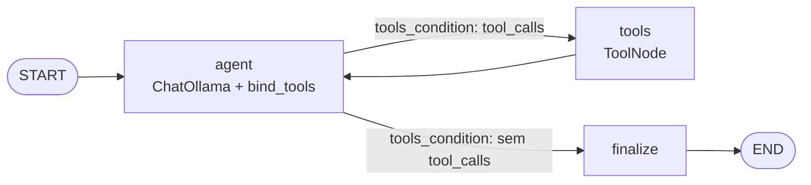

# Arquitetura LangGraph (StateGraph explícito)

Documento de referência do projeto **Crypto Intelligence Agent — evolução LangGraph**, que usa como base o código
das Fases 1 a 5 (commit `0f9e5a6`). Diário do projeto em [Report/langgraph/](../Report/langgraph/README.md).

Estado atual: **Etapa 1** — grafo ReAct mínimo (`agent` → `ToolNode` → `agent`, `tools_condition`).

## 1. Classificação da arquitetura anterior: LLM Call, Chain ou Router

| Tipo | Definição | Agente anterior |
|---|---|---|
| LLM Call | Uma chamada ao modelo, sem ferramentas nem passos | Não: usa ferramentas externas (CoinPaprika, SQLite, Chroma, cálculo) |
| Chain | Sequência fixa de passos definida no código | Não, no núcleo: a ferramenta e o número de passos são escolhidos em tempo de execução |
| **Router** | O modelo decide para onde a execução segue | **Sim**: o modelo escolhe quais ferramentas chamar conforme a pergunta |

O agente anterior é **primariamente um Router com comportamento agêntico ReAct**:

- decide as ferramentas por pergunta (tool calling nativo do Ollama), em vez de seguir um caminho fixo;
- itera raciocínio → ação → observação: o resultado de uma ferramenta pode levar a outra chamada (ex.: banco local
  sem registros → `get_price_history`);
- a observação influencia a decisão seguinte, até o modelo responder sem pedir ferramenta.

Há trechos de Chain em volta do Router: o prefetch fixo das comparações entre redes e a sequência
verificação → correção única → resposta cautelosa são passos determinísticos em Python
([app/integrated/service.py](../app/integrated/service.py)).

### Duas implementações anteriores

| | Fase 2 (legado) | Fase 5 (baseline principal) |
|---|---|---|
| Código | [app/legacy/react_agent.py](../app/legacy/react_agent.py) | [app/integrated/agent.py](../app/integrated/agent.py) + [service.py](../app/integrated/service.py) |
| Laço | `AgentExecutor` (`initialize_agent`, `ZERO_SHOT_REACT_DESCRIPTION`) | `langchain.agents.create_agent` (grafo LangGraph pronto) |
| Protocolo | Texto livre (`Thought/Action/Action Input/Final Answer`) | Tool calling nativo (JSON estruturado) |
| Estado | Implícito no executor | Implícito no grafo pronto; nada recuperável entre turnos |
| Verificação e correção | — | Python imperativo, fora do laço |

## 2. AgentExecutor/`create_agent` × StateGraph explícito

| Aspecto | Antes | StateGraph explícito |
|---|---|---|
| Fluxo | Laço escondido no executor ou no grafo pronto | Nós e arestas declarados em [app/graph/builder.py](../app/graph/builder.py) |
| Estado | Variáveis locais e listas de mensagens | `ReactState` tipado ([app/graph/state.py](../app/graph/state.py)) com redutores |
| Roteamento | Interno | `tools_condition` + arestas condicionais visíveis |
| Etapas extras (verificação, correção) | Código em volta do agente | Nós do mesmo grafo (etapas seguintes) |
| Teste | Fim a fim | Por nó (função `estado → atualização`) e por transição |
| Persistência/recuperação | Nenhuma (Fase 5 recusou o checkpointer) | Checkpointer por `thread_id` (Etapa 3) |
| Observabilidade | Spans `@traceable` manuais | Cada nó vira um span no LangSmith, com metadados da arquitetura |

O objetivo não é trocar uma API por outra: é tornar explícitos fluxo, transições de estado, roteamento
condicional, persistência e recuperação.

## 3. Grafo ReAct (Etapa 1)

### Estado (`ReactState`)

| Campo | Redutor | Conteúdo |
|---|---|---|
| `messages` | `add_messages` | Human, AI (com `tool_calls`) e Tool do turno; cada nó devolve só as novas |
| `user_query` | substitui | Pergunta original do turno |
| `llm_calls` | soma de listas | Por chamada ao modelo: nó, latência, ferramentas pedidas, tokens de entrada/saída |
| `final_response` | substitui | Texto entregue, preenchido por `finalize` |

O prompt do sistema (o mesmo `SYSTEM_PROMPT` do agente integrado) é acrescentado pelo nó `agent` a cada chamada e
não entra no estado, para não se repetir no histórico nem no checkpoint. Campos de evidência, verificação e
correção só entram no estado quando os nós que os produzem existirem.

### Nós

| Nó | Responsabilidade | Código |
|---|---|---|
| `agent` | Chama o modelo com as ferramentas vinculadas (uma vez, na montagem) e registra latência/tokens | `make_agent_node` em [nodes.py](../app/graph/nodes.py) |
| `tools` | `ToolNode` com as ferramentas existentes; executa várias chamadas da mesma mensagem | [builder.py](../app/graph/builder.py) |
| `finalize` | Última `AIMessage` sem `tool_calls` → `final_response` | `finalize` em [nodes.py](../app/graph/nodes.py) |

### Decisões

- **Erros de ferramenta.** O tratamento padrão do `ToolNode` (langgraph-prebuilt 1.1.1) só converte argumentos
  inválidos e relança as outras exceções, o que derrubaria o turno. `tool_error_observation` converte qualquer
  exceção na mesma observação JSON de erro das ferramentas (`ok=false`, `kind=tool_error`), com `status="error"`.
- **Limite de iterações.** `graph_config(max_iterations)` define `recursion_limit = 2 × max_iterations + 3`
  (agent + tools por iteração, mais a última chamada ao agente, o `finalize` e a folga que o LangGraph exige:
  passos < limite). Excedido → `GraphRecursionError`. Usa o mesmo `AGENT_MAX_ITERATIONS` (6) do projeto-base.
- **Reuso.** Ferramentas (`structured_tools`), prompt (`SYSTEM_PROMPT`) e leitura de trajetória (`trajectory`)
  vêm de `app/integrated`, então as duas arquiteturas são medidas pela mesma régua.
- **Grafo reutilizável.** Compilado uma vez; nenhum nó guarda estado próprio, então o mesmo objeto atende
  requisições concorrentes.

## 4. Compatibilidade do tool calling do Ollama no grafo

Verificada em execução real (2026-11-23, `gemma4:e2b`, CPU), não pelo nome do modelo. Evidência:
[docs/evidence/langgraph/etapa-01-react-live.jsonl](evidence/langgraph/etapa-01-react-live.jsonl).

| Item | Resultado |
|---|---|
| Vínculo (`bind_tools`) | OK com `ChatOllama` (langchain-ollama 1.1.0) |
| Escolha | `get_market_data` para preço; `calculate_percent_change` para variação; nenhuma ferramenta para saudação |
| Execução | `ToolNode` executou as chamadas reais (CoinPaprika e cálculo local) |
| Uso do resultado | Resposta cita o preço observado (diferença < 1%) com fonte e horário |
| Várias chamadas | BTC e ETH pedidos **na mesma `AIMessage`**; `ToolNode` executou as duas antes de voltar ao agente |
| Resposta final | Gerada após o retorno ao nó `agent` |
