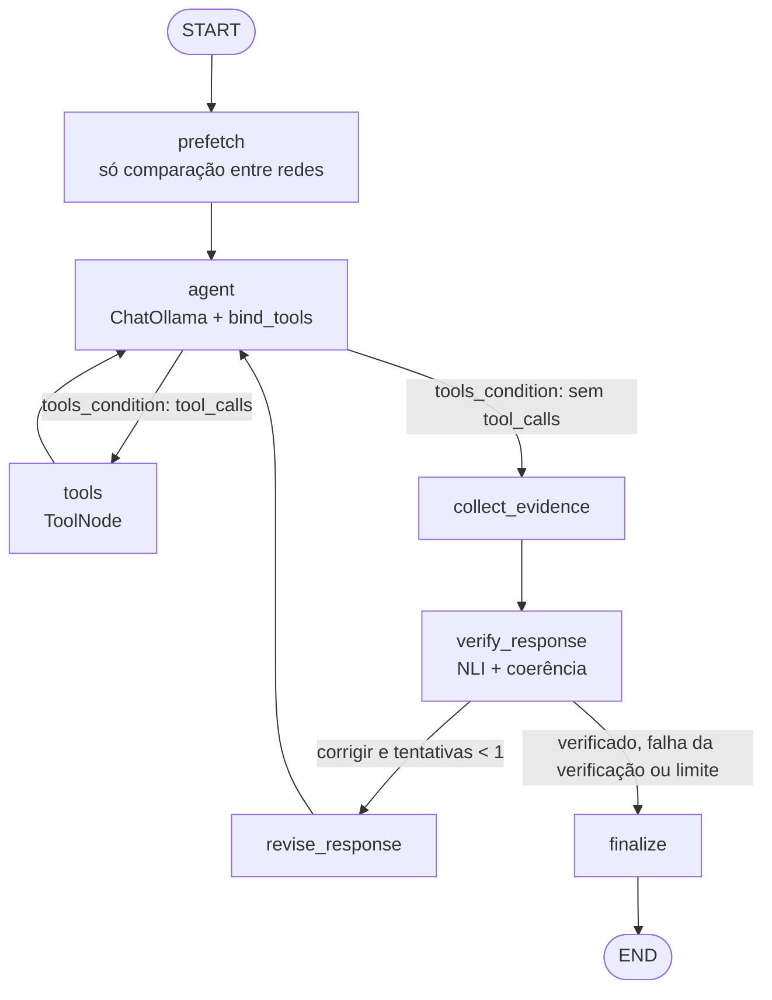

# Arquitetura LangGraph (StateGraph explícito)

Documento de referência do projeto **Crypto Intelligence Agent — evolução LangGraph**, que usa como base o código
das Fases 1 a 5 (commit `0f9e5a6`). Diário do projeto em [Report/langgraph/](../Report/langgraph/README.md).

Estado atual: **Etapa 2** — grafo ReAct com as 9 ferramentas, pré-consulta, coleta de evidência, verificação e
correção única como nós.

## 1. Classificação da arquitetura anterior: LLM Call, Chain ou Router

| Tipo | Definição | Agente anterior |
|---|---|---|
| LLM Call | Uma chamada ao modelo, sem ferramentas nem passos | Não: usa ferramentas externas (CoinPaprika, SQLite, Chroma, cálculo) |
| Chain | Sequência fixa de passos definida no código | Não, no núcleo: a ferramenta e o número de passos são escolhidos em tempo de execução |
| **Router** | O modelo decide para onde a execução segue | **Sim**: o modelo escolhe quais ferramentas chamar conforme a pergunta |

O agente anterior é **primariamente um Router com comportamento agêntico ReAct**:

- decide as ferramentas por pergunta (tool calling nativo do Ollama), em vez de seguir um caminho fixo;
- itera raciocínio → ação → observação: o resultado de uma ferramenta pode levar a outra chamada (ex.: banco local
  sem registros → `get_price_history`);
- a observação influencia a decisão seguinte, até o modelo responder sem pedir ferramenta.

Há trechos de Chain em volta do Router: o prefetch fixo das comparações entre redes e a sequência
verificação → correção única → resposta cautelosa são passos determinísticos em Python
([app/integrated/service.py](../app/integrated/service.py)).

### Duas implementações anteriores

| | Fase 2 (legado) | Fase 5 (baseline principal) |
|---|---|---|
| Código | [app/legacy/react_agent.py](../app/legacy/react_agent.py) | [app/integrated/agent.py](../app/integrated/agent.py) + [service.py](../app/integrated/service.py) |
| Laço | `AgentExecutor` (`initialize_agent`, `ZERO_SHOT_REACT_DESCRIPTION`) | `langchain.agents.create_agent` (grafo LangGraph pronto) |
| Protocolo | Texto livre (`Thought/Action/Action Input/Final Answer`) | Tool calling nativo (JSON estruturado) |
| Estado | Implícito no executor | Implícito no grafo pronto; nada recuperável entre turnos |
| Verificação e correção | — | Python imperativo, fora do laço |

## 2. AgentExecutor/`create_agent` × StateGraph explícito

| Aspecto | Antes | StateGraph explícito |
|---|---|---|
| Fluxo | Laço escondido no executor ou no grafo pronto | Nós e arestas declarados em [app/graph/builder.py](../app/graph/builder.py) |
| Estado | Variáveis locais e listas de mensagens | `ReactState` tipado ([app/graph/state.py](../app/graph/state.py)) com redutores |
| Roteamento | Interno | `tools_condition` + arestas condicionais visíveis |
| Etapas extras (verificação, correção) | Código em volta do agente | Nós do mesmo grafo (etapas seguintes) |
| Teste | Fim a fim | Por nó (função `estado → atualização`) e por transição |
| Persistência/recuperação | Nenhuma (Fase 5 recusou o checkpointer) | Checkpointer por `thread_id` (Etapa 3) |
| Observabilidade | Spans `@traceable` manuais | Cada nó vira um span no LangSmith, com metadados da arquitetura |

O objetivo não é trocar uma API por outra: é tornar explícitos fluxo, transições de estado, roteamento
condicional, persistência e recuperação.

## 3. Grafo ReAct

`prefetch` e a verificação são opcionais na montagem (`prefetch=True`, `verifier=...`). Sem verificador,
`collect_evidence` vai direto ao `finalize` (forma usada nos testes da Etapa 1).

### Estado (`ReactState`)

| Campo | Redutor | Conteúdo |
|---|---|---|
| `messages` | `add_messages` | Human, AI (com `tool_calls`) e Tool; cada nó devolve só as novas |
| `user_query` | substitui | Pergunta original do turno |
| `turn_id` | substitui | `id` da `HumanMessage` da pergunta; o turno começa nela (evidência só do turno atual) |
| `tool_results` | substitui | `ToolStep` do turno inteiro (categoria, args, ok, erro, saída) + `latency_s` |
| `evidence` | substitui | Observações JSON das ferramentas, com `source` (provedor, endpoint, horários) intacto |
| `draft_answer` | substitui | Resposta atual do agente (antes da correção e dos ajustes finais) |
| `verification_result` | substitui | `VerificationResult` serializado (NLI, achados lógicos, instruções de correção) |
| `correction_attempts`, `original_answer`, `original_status` | substitui | Correção única |
| `llm_calls` | soma de listas, zerada por turno (`Overwrite`) | Por chamada ao modelo: latência, ferramentas pedidas, tokens |
| `final_response`, `execution_metadata` | substitui | Resposta entregue; status (`complete`/`partial`/`failed`) e limitações |

Tudo é serializável em JSON (dicts, não modelos Pydantic), porque o estado vai para o checkpoint (Etapa 3). O
prompt do sistema (`SYSTEM_PROMPT` do agente integrado) é injetado pelo nó `agent` a cada chamada e não entra
no estado. `turn_input` monta a entrada de cada turno: dá `id` à pergunta e zera os campos do turno anterior.

### Nós

| Nó | Responsabilidade | Reaproveita |
|---|---|---|
| `prefetch` | Comparação entre redes: consulta base, perfil e mercado de cada rede antes do modelo; nas demais perguntas não faz nada | `network_comparison`, `comparison_calls`, `prefetch_messages`, `comparison_instruction` |
| `agent` | Chama o modelo com as ferramentas vinculadas (uma vez, na montagem); registra latência e tokens | `SYSTEM_PROMPT` |
| `tools` | `ToolNode` com as 9 ferramentas; várias chamadas da mesma mensagem; mede latência (`wrap_tool_call`) | `structured_tools` |
| `collect_evidence` | Trajetória, observações e resposta atual do turno inteiro (pré-consulta + laço + correção) | `trajectory` |
| `verify_response` | Verifica a resposta contra as observações reais | `VerificationService` |
| `revise_response` | Feedback estruturado (verificação + falhas do agente por regra) como nova mensagem | `correction_feedback` |
| `finalize` | Resposta cautelosa se a correção falhou, ajustes garantidos por código, status e limitações | `settle_correction`, `deliverable_answer`, `reply_status` |

As funções de política (`agent_failed`, `should_correct`, `correction_feedback`, `settle_correction`,
`deliverable_answer`, `reply_status`) foram **extraídas** de `IntegratedAgentService` para funções de módulo em
[app/integrated/service.py](../app/integrated/service.py), sem mudar o comportamento (suíte da Fase 5 inalterada e
verde). O serviço da Fase 5 e o grafo chamam as mesmas funções; nada foi duplicado.

### Roteamento

| Origem | Função | Destinos |
|---|---|---|
| `agent` | `tools_condition` (LangGraph) | `tools` se há `tool_calls`; senão `collect_evidence` |
| `verify_response` | `route_after_verification` | `revise_response` se `should_correct` (status `contradicted`/`unsupported`/`partially_verified`, ou falha do agente detectada por regra: resposta vazia, recusa sem consulta, comparação sem a base, histórico sem `get_price_history`) e `correction_attempts < 1`; senão `finalize` |

### Decisões

- **Pré-consulta fixa (ordem imposta).** Mantida do projeto-base, só para comparação entre redes: com o
  `gemma4:e2b`, o modelo ignorava o roteamento nesse caso (Fase 5, seção 5.11). É o único ponto com ordem fixa
  de ferramentas; as demais perguntas seguem a escolha do modelo. No teste real da Etapa 2, a comparação
  Solana × Ethereum usou 7 consultas pré-feitas e 1 chamada ao modelo (167 s no total).
- **Erros de ferramenta.** O tratamento padrão do `ToolNode` (langgraph-prebuilt 1.1.1) só converte argumentos
  inválidos e relança as outras exceções, o que derrubaria o turno. `tool_error_observation` converte qualquer
  exceção na mesma observação JSON de erro das ferramentas (`ok=false`, `kind=tool_error`), com `status="error"`.
- **Limite de passos.** `graph_config(max_iterations)` define `recursion_limit` para até `max_iterations`
  rodadas de ferramenta em cada passada (resposta + 1 correção), mais pré-consulta, `revise_response`,
  `finalize` e a folga que o LangGraph exige (passos < limite): 34 com `AGENT_MAX_ITERATIONS=6`. Excedido →
  `GraphRecursionError`.
- **Correção limitada.** `max_corrections` (padrão `MAX_CORRECTIONS=1`, do projeto-base) torna o laço
  `verify → revise → agent` finito.
- **Grafo reutilizável.** Compilado uma vez; nenhum nó guarda estado próprio.

## 4. Compatibilidade do tool calling do Ollama no grafo

Verificada em execução real (2026-11-23, `gemma4:e2b`, CPU), não pelo nome do modelo. Evidência:
[docs/evidence/langgraph/etapa-01-react-live.jsonl](evidence/langgraph/etapa-01-react-live.jsonl).

| Item | Resultado |
|---|---|
| Vínculo (`bind_tools`) | OK com `ChatOllama` (langchain-ollama 1.1.0) |
| Escolha | `get_market_data` para preço; `calculate_percent_change` para variação; nenhuma ferramenta para saudação |
| Execução | `ToolNode` executou as chamadas reais (CoinPaprika e cálculo local) |
| Uso do resultado | Resposta cita o preço observado (diferença < 1%) com fonte e horário |
| Várias chamadas | BTC e ETH pedidos **na mesma `AIMessage`**; `ToolNode` executou as duas antes de voltar ao agente |
| Resposta final | Gerada após o retorno ao nó `agent` |

## 5. Ferramentas no grafo (Etapa 2)

As 9 ferramentas do agente integrado entram sem mudança de nome, descrição, esquema de argumentos, tratamento de
erro nem formato de observação (`ok`/`error`/`source`):

| Categoria | Ferramentas |
|---|---|
| API (CoinPaprika ao vivo) | `search_crypto_asset`, `get_market_data`, `get_market_details`, `get_asset_profile`, `get_price_history`, `get_global_market` |
| SQL (snapshots SQLite, Text-to-Query) | `query_market_database` |
| RAG (Chroma + Retrieval Agent com Query Rewriting) | `search_knowledge_base` |
| Determinística | `calculate_percent_change` |

Evidência real (2026-11-24, `gemma4:e2b`, CPU):
[etapa-02-tools-live.jsonl](evidence/langgraph/etapa-02-tools-live.jsonl) e
[etapa-02-rewrite-probe.jsonl](evidence/langgraph/etapa-02-rewrite-probe.jsonl).
